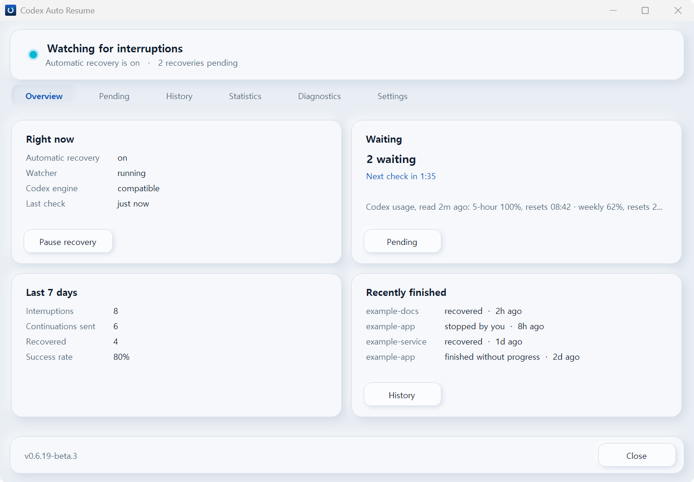
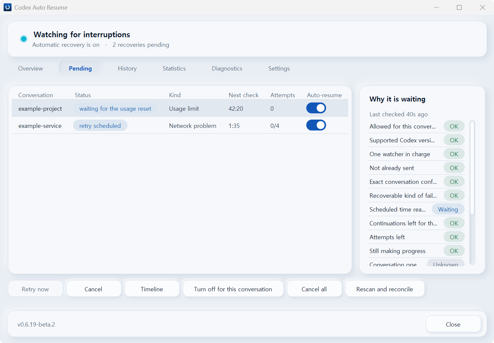
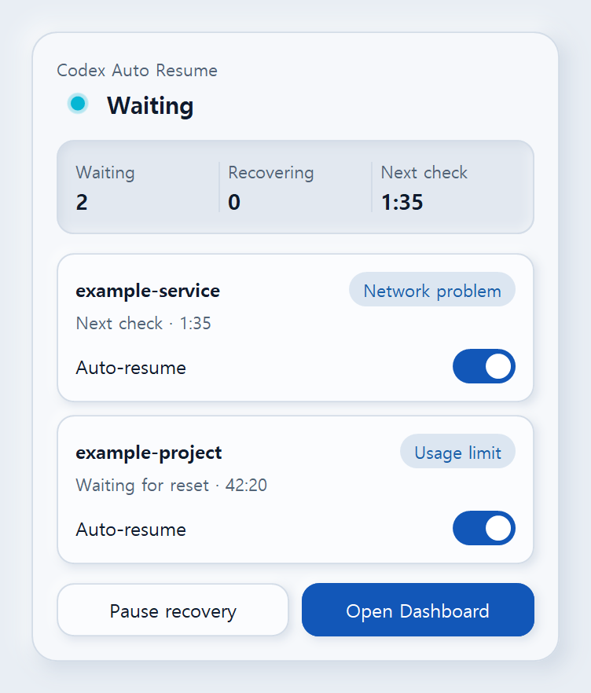
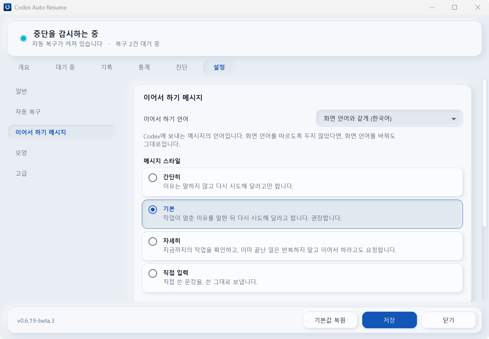

# Codex Auto Resume roadmap: v0.6.3 → v0.6.22

This is the current development direction for Codex Auto Resume from v0.6.3.

This is a **planned roadmap, not a promise**. Details may change as Codex evolves or as testing
reveals better or safer implementation paths.

The overall direction is:

**finish the UI → add compatibility intelligence → fix the window's lag → clean up Python → add
advanced features, more than any program like this, in two editions → stabilize Python → replace the
core with Rust and make it Rust-native → stabilize Rust**

The default recovery behavior stays as conservative as it has always been, through every release
here: what v0.6.11, v0.6.12, v0.6.14, v0.6.16, v0.6.18 and v0.6.19 add to it is there for a person to turn on, never
on by itself - except fixes: v0.6.15's detection of the conversations Codex hands over, and v0.6.18's judgment of a
cut-off recovery turn, are on by themselves.

---

## v0.6.3 — Released ✅

v0.6.3 was the major feature and UX expansion release.

It added, among other things:

- nine interface languages,
- separate interface and continuation-message languages,
- reason-aware continuation messages,
- Minimal / Standard / Detailed / Custom message styles,
- global and per-reason Custom messages,
- richer Dashboard and Tray controls,
- improved notifications,
- broader Python CI coverage.

The recovery safety model remained deliberately conservative.

---

## v0.6.4 — Design consistency, neumorphic refinement, and responsiveness ✅

**Released.**

v0.6.4 finished the UI introduced in v0.6.3 rather than expanding the recovery engine:

- one neumorphic design across the Dashboard and Settings window, the notification-area popup
  and the panel in Codex, taken from the panel,
- light and dark themes that follow Windows by default, with a choice in Settings,
- a window that opens at 1000 × 632 with a first screen that never scrolls,
- soft scroll bars in place of Windows' own,
- switches for things that run, check boxes for picking items from a list,
- language and theme changes applied at once, with the window reopening itself where it has to,
- page switches from about 100 ms to about 22 ms, and a usable window about 3 seconds sooner,
- the status light back in its pre-v0.6.3 colour, with a gentle glow.

Recovery decides exactly what it decided in v0.6.3.

### Screenshots

#### Dashboard — Overview



#### Dashboard — Pending



#### Notification-area popup



#### Settings — Korean



---

## v0.6.5 — Codex Compatibility Registry, interface polish, and groundwork for the split ✅

**Released.**

v0.6.5 carries the Codex Compatibility Registry and the interface work that came out of using
v0.6.4, and lays the groundwork for splitting the Python implementation, which moved to v0.6.10's alpha.

### Codex Compatibility Registry

This release is also planned to introduce explicit Codex compatibility states:

- **VERIFIED** — maintainer-tested
- **COMPATIBLE** — local structural checks pass, but not yet formally verified
- **INCOMPATIBLE** — known unsafe or incompatible
- **UNKNOWN** — compatibility cannot be established

Where useful, compatibility should be tracked per capability rather than only per whole Codex
version.

For example:

```text
Codex x.y.z

Usage-limit detection   ✓ Verified
Exact-thread recovery   ✓ Verified
Recovery-turn tracking  ✓ Verified
Empty-response recovery ? Unverified
notLoaded recovery      — Unsupported
```

Remote compatibility data must **never override failed local safety checks**.

If the registry cannot be reached, the intended fallback is:

```text
validated cache
    ↓
local structural checks
    ↓
UNKNOWN / fail closed if still uncertain
```

No telemetry is required for this system.

The Compatibility Registry's data ships inside each release and is refreshed only when you ask -
from Diagnostics, or when you check for updates. There is no background traffic. The first
release that carries it lists no capability as VERIFIED: that state needs recorded evidence.

### Interface

Interface work that came out of using v0.6.4:

- a status light you can actually see breathing,
- motion on the notification-area icon itself: a slow breathe with an occasional slow turn while
  watching, and a turning arc while a recovery is being sent,
- a notification card in the product's own design, with a silent copy in Action Center, and
  Windows' own notification wherever a card must not appear (a locked session, a full-screen
  app, Do Not Disturb, a running screen reader),
- real depth inside the notification-area popup,
- the first screen's card buttons back at the bottom-left, with its proportions redone,
- drop-down lists drawn in the same neumorphic material as the cards, in the window and in the panel,
- switches that glide when they change,
- lists that never overflow sideways.

### Fixes and groundwork for the split

- three fixes found while planning the refactor,
- tests that keep every safety check reading the whole package, so that moving code can never
  quietly take it out of a check's sight,
- screenshot checks keyed on what the window is shown rather than on which files changed.

---

## v0.6.6 — The ordinary breath, a taskbar button that moves where it is installed, and the last native controls ✅

**Released.**

What a day of real use turned up. Nothing about recovery changed.

The status light is the ordinary breath now: one symmetric cosine over 4.4 seconds, taken in
light and drawn through the screen's gamma, with a deep swing and a glow that rides the
brightness and reaches a share of the dot rather than a count of pixels. One table serves the
window, the notification-area popup, the panel in Codex and the notification card, so all four
breathe alike, and the icon's own breath and sweep read the same rhythm.

v0.6.5 moved the mark on the window's taskbar button, and it never moved on an installed one: an
installed window is resolved to the application the installer registered, and such a button wears
the icon that identity carries rather than the window's own. The window now takes a taskbar
identity of its own, and the button moves where people actually have it.

And the controls that were still Windows' or the browser's are the product's: every scroll bar,
on either axis and wherever one appears, with its track coloured against the ground it runs over;
and the message box, which is now a dialog in the window's own material whose buttons say what
will happen rather than Yes and No. The documentation's pictures move, and they no longer carry
the black frame `PrintWindow` never drew - they are cut to the window and the corners Windows
rounds are rounded in them.

The panel in Codex gets a theme of its own, Theme in Codex, right under the Theme: Same as Theme,
which is the default and what every panel did before, Codex's theme, Light or Dark. The window,
the popup and the notification card keep the Theme.

---

## v0.6.7 — Compatibility in tiers, Failed here, and a notification card that breathes ✅

**Released.**

The Compatibility Registry learns to say how much stands behind its word, and the notification
card's light joins the others. For a Codex version the data says nothing about, recovery decides
exactly what it decided in v0.6.6.

Each capability, on each exact Codex version, now resolves to one of six states, in this order:

- **VERIFIED** — a real recovery on this exact version exercised it, and none failed
- **CHECKED** — new: the maintainer's local checks passed on this exact version, and nothing
  confirmed more
- **COMPATIBLE** — the data makes no claim, and the checks on this computer pass
- **FAILED_HERE** — new: the data checked or verified this exact version, but a check on this
  computer failed, so the cause is most likely this computer rather than the Codex version
- **INCOMPATIBLE** — a check on this computer failed on a version nobody checked, or the data says
  it does not work
- **UNKNOWN** — compatibility cannot be established

The rules stay as they were: a failed local check always wins, and is now INCOMPATIBLE or
FAILED_HERE; data can only restrict, or raise a local pass - to CHECKED or VERIFIED - for an exact
version. CHECKED sends exactly as COMPATIBLE and VERIFIED do; like VERIFIED, it needs recorded
evidence and expires with the fetched data. FAILED_HERE blocks every send exactly as INCOMPATIBLE
does, and says so: a recovery it holds says *Codex checks failed on this computer*, and the
notification-area popup and its icon ask for attention. The advanced tier planned then stayed
VERIFIED-only; v0.6.11's own plan, below, lifts that for what it adds.

The data on main is fetched by every installed release, so each must take the newest whole, with
its own validator: v0.6.5 and v0.6.6 skip CHECKED, a state they do not know, and nothing they decide
moves. And new data can be published between releases without turning main red: the behaviour
tests and the pictures read a frozen copy of v0.6.6's data, while the live file is still held to its
evidence rules.

The notification card's status light breathes on the same table as the window, the popup and the
panel in Codex, where v0.6.6 drew it lit and still on purpose. Reduce motion and High Contrast keep
it still.

---

## v0.6.8 — A tray icon without its badge, and lights that never stop ✅

**Released.**

The notification-area icon wore a small status dot in its corner that the window's taskbar button
never had, so during a recovery the tray showed a second light the taskbar did not. The dot is gone:
the head of the mark says the state on its own, and the tray icon and the taskbar button are one
picture.

Needing attention and a failure pulsed once and then held still. Now neither stops for as long as
it lasts: attention's amber light breathes slowly, every 5.6 seconds - slower than monitoring's
4.4 - and a failure's red light quickly, every 1.2 seconds. The tray icon and the taskbar button,
which nothing put in the failed state before, now turn red when a recovery fails, their head
sweeping along the ring twice as quickly as a recovery's and blinking as it goes, and stay red until
you have seen it.
Reduce motion and High Contrast still hold every light still.

---

## v0.6.9 — The window's lag, and starting with Codex ✅

**Released.**

First, and on its own terms: the window's responsiveness - the lag it still has, worst on some pages,
and the loading that feels slower in every language but English (reported with v0.6.8). Each is
measured where it happens, its cause found and fixed, and the measurement kept as a test. Before the
split rather than after it: the split's golden copies then hold the faster window, and the split
carries it, instead of the fix being made again on code that has just moved. It changes how fast the
window is, and that is worth a release of its own, so it is one.

### v0.6.9-alpha ✅ — starting with Codex, measured (a pre-release)

Two facts about starting with Codex cannot be read out of any source: when Codex starts a plugin's
MCP server, and what becomes of a watcher that server started when Codex closes. Both are answers
only a machine running the real thing can give, so the switch and the measurement it needs were
built first and published as **v0.6.9-alpha**, a pre-release, for exactly that: it is a stage the
work had to be split into, not a release of its own. Nothing is served it - `releases/latest` never
answers with a pre-release - and it is not on main, so the plugin's own route never offers it. It
also carries the lights and the pictures below, which arrived with it.

### Starting with Codex: measured, and not shipped

Today the watcher starts when you sign in to Windows. The other choice - start it when Codex starts -
was built for v0.6.9-alpha and measured on a real machine, because two facts about it cannot be read
out of any source. Both now have answers, from Codex 26.915 on 2026-09-23:

- **When does Codex start a plugin's MCP server?** About 22 seconds after the app opens, several
  times, and it cancels each one a few seconds after it has listed its tools.
- **What becomes of a watcher that server starts?** It is killed with the server. Codex runs each
  MCP server in a Windows job object with `KILL_ON_JOB_CLOSE` and without `BREAKAWAY_OK`, so a
  process started there cannot leave the job and dies when the job closes. Six starts were measured;
  six watchers, each gone within about six seconds.

A watcher killed a few seconds after it starts, over and over, is the opposite of what this product
is: one that is stopped mid-tick cannot prove whether it sent a continuation. So the switch is not
offered. `Control.start_for_codex` refuses where the job would end the watcher and writes what the
job said to `logs/codex-start.log`, so the next Codex is one line away from being measured again, and
the advanced edition builds it properly in v0.6.11 - starting a process outside the host's job is
exactly the kind of thing that edition exists to let a person turn on.

### A shorter README

The README had grown to a thousand lines. It becomes the short version - what the product does, how
to install it, the one limitation to know, where everything else is - and the full text moves, as it
was, to [the guide](GUIDE.md), in both languages.

---

## v0.6.10 — Python modularization, then the design settled and a grade for what others report ✅

**Released.**


v0.6.10 arrives in two stages: **v0.6.10-alpha**, a pre-release, is the modularization and nothing
else; the final **v0.6.10** is the design audit, the choice of appearance and the new Reported grade,
built on the boundaries the alpha leaves. A pre-release is for a stage the work has to be split into that is not a release on
its own, and the modularization is that: it changes nothing anybody could see, so it is not worth a
release by itself, and it has to be finished and published before what is built on it. The design is
the opposite - it changes what everything looks like - so it is a release.

### v0.6.10-alpha ✅ — Python modularization (a pre-release)

The alpha is the major structural cleanup of the Python implementation. It was the main part of
v0.6.5 in the earlier plan, and then of v0.6.8 and v0.6.9; v0.6.5 shipped its groundwork, and the
split itself is here. The line ceilings hold again from the alpha on, and no module is over them.

Before anything moves:

- golden copies of the replies the window and the panel in Codex receive, so a split that changes
  a single byte of them fails,
- one implementation of rules that were written more than once, shared identifiers and
  vocabularies, and typed contracts between the layers.

Main goals:

- split oversized modules,
- separate responsibilities more clearly,
- clarify boundaries between engine, state, store, adapters, and control layers,
- remove duplication,
- strengthen typed contracts,
- isolate more pure/testable logic,
- prepare clean boundaries for the later Rust migration.

The window's largest C# files may be split the same way, behind the same kind of safety net.

The repository's landing page on GitHub is tidied in the same stage, while paths are moving
anyway, so that fewer files sit at its root.

Bugs discovered during this refactor will be fixed with regression tests, but the alpha is
**not intended to be the full repository-wide bug hunt**; v0.6.20 is. It is the modularization and
nothing else: no feature, and no change anybody could see.

What it carries: the modules that were over their ceiling are packages in the plan's layout -
`codex/`, `win/`, `domain/`, `runtime/`, `commands/`, `compat/` and `ui/card/` among them - each old
module kept as a front that still answers every name it had, and no import cycle is left. The
replies the window and the panel receive are written down as types and held to the golden copies
both ways. The window's three hand-written C# files are eighteen, grouped by half in
`gui/window.sources`, and the contributor documents moved into `docs/`. `tests/test_stack.py` names
the Rust part every module becomes, and fails when a placement stops being true.


### v0.6.10 ✅ — The design audit, and a choice of appearance

The final v0.6.10 is the design, settled, and the one new word that comes with it - Reported, below.
It is a release of its own because it is worth one: it changes what every surface looks like, which is exactly what a person sees. It sits
here and not elsewhere for four reasons. After the alpha, because four looks in light and dark are
only safe to build once the drawing lives in modules. Before the two editions, so both inherit one
settled design instead of being audited twice. Before Rust, so the port copies a finished look. And
the audit before the choice, because the other looks are derived from today's, so today's has to be
right first.

- a design audit of the panel in Codex, the app, the notification-area popup and the notification
  card, side by side in light and dark, fixing everything that does not yet look like one product -
  among them every light that says a state and does not move: the panel's 8 px dot on the Automatic
  recovery tile is still while the status light above it breathes, and the user's rule is that a
  light which says the product is running does not sit still. The pictures follow: the generator
  animates one light per picture today, and will animate every light a surface moves,
- a choice of appearance: today's design, the same without motion, v0.6.2's plainer look (with
  today's status light), and a fully plain one - each in light and dark,
- then the advanced features and the two editions below.

---

### Compatibility reports from others

The two programs that carry this now exist, outside the product and outside its releases: the
maintainer's own management program, and
[codex-compat-reporter](https://github.com/songyb111-gachon/codex-compat-reporter), which anyone can
run on their own machine to write one report and send it. What is left for v0.6.10 is this
repository's side of it - the check that reads such a pull request as data, and showing what arrives
beside a version. None of it can be made up without it showing:

- **A report is what the program measured, not what a person typed.** The program runs the checks on
  the contributor's own machine and writes the report itself: the Codex version the product read from
  the engine, the fingerprint of the setup that measured it, each check it ran and its result. The
  fields a person might be tempted to choose - which tier a version earns, whether a check counts as
  exercised - are derived from the measurements, and the repository derives them again when the
  report arrives, so a hand-edited conclusion does not survive.
- **A report arrives as a pull request, and is checked as data.** A check that runs on every such pull
  request reads the files without running anything in them, accepts only new files under the
  contributor's own GitHub name (the one who opened it), rejects a report whose version, fingerprint
  or dates are not plausible, and refuses a duplicate. A report found to be wrong can be withdrawn,
  in the open. v0.6.10 still had a maintainer merge each one; since it was released, one that passes
  is filed with no step by the maintainer, by the rules below.

  The fingerprint is the setup that measured: the product's own version, the reporting program's and
  Windows'. Each has to be one that could have written the report - a Codex version the product
  itself names engines by, a product version that is one of this repository's releases and was out
  before the report was written, a plain release of the reporting program (three numbers, nothing
  after them) from 1.0.0 on, Windows 10 or later - and the times have to be ones the machine could
  have recorded: none before the project existed, none after the report was written, and each
  record's delivery and outcome after its detection. It names the setup, not the binary. A digest of
  codex.exe itself, the same on every machine with that build and naming nobody, would tie a report
  to the exact binary; the report format carries none yet, and adding one needs a new format in both
  programs, which is this check's next step. The product's own digest is of codex.exe's path, which
  holds the Windows user name, so it never leaves the machine. A duplicate is a second report for the
  same GitHub name and Codex version, or a copy: a report with at least one record whose records -
  their times and states, in order - are those of a report already filed for the same version. A
  report with no records has nothing to copy and is never refused as one.
- **What others report is shown, and changes nothing.** It has a grade of its own, *Reported*, which
  stands beside the ladder of Verified, Checked, Compatible and Failed here and never becomes one of
  them. It is listed beside the version, with the number of reports that said the same thing - one
  per GitHub name per Codex version, so a number of reports and not of machines: N reported it
  working, M reported a failure, K reported nothing either way. A report is counted as worked when at
  least one of its records was delivered and ended in the state `recovered`; as failed when at least
  one delivered record ended in `recovery_turn_failed`, `failed` or `terminal_failure`; and as
  neither when no delivered record ended in either, which includes a report with nothing delivered at
  all. One report can be counted in both columns when different records say different things, and
  that is shown rather than resolved, so worked, failed and neither, less the reports counted twice,
  add up to the reports. Only a filed report counts - one still waiting in a pull request counts
  nowhere - and a report's own levels and verdict never do. Reported never raises a
  version to Verified or Checked - a version whose own evidence says nothing stays Compatible however
  many reports arrive - and it never changes what the product lets itself do: those tiers stay the
  maintainer's own, earned the way they are today.

The reports stay in their own folder, `docs/evidence/community/`, and never enter the compatibility
data. Only their counts travel, in a file of their own that each release carries beside the
compatibility data and never inside it: the product reads it to show the counts, and nothing that
decides reads it at all. No request fetches it - the refresh a person asks for still fetches the
compatibility data and nothing else - so a count newer than the installed release waits for the next
one.

This is honest about its limit: nothing can prove a report was not fabricated on the contributor's
own machine. So what others report informs, and only the maintainer's own evidence decides.

Filing needs no maintainer. After v0.6.10 was released the repository took over the last step a
person was taking: `.github/workflows/community-file.yml` files what the check accepts, judged
again against `main` as it is by then, as `main`'s own regeneration of the report, and tells the
sender in one comment. The judgement a maintainer applied is written down as rules instead - how
old the sending account is, one open report per account, how many reports per account and per
Codex version in a week, how many Codex versions the project's data does not name, a failure on a
verified version held for the maintainer - and every number they count comes from `main`'s own
history. It is the repository's work, not a release's: the counts still reach a machine only with
the next release.

The management program stays a program of its own, and its features also come into the advanced
edition, so a person using that edition can record and submit a report without a second tool. The
standard edition sends nothing and gains nothing here: a report goes to GitHub only when its author
opens the pull request.

---

## v0.6.11 — Two editions, and the advanced edition's first capabilities ✅

**Released, after four pre-releases.**


v0.6.11 arrives in stages. **v0.6.11-alpha**, a pre-release, is the ground both editions stand on
and nothing else: the two editions built, audited and published together, updates that stay in
their edition, the places where core asks, and the advanced edition's own state, switches and
measurements - with no capability yet to switch on. That is not a release on its own, and
everything after it is built on it. **v0.6.11-beta**, a pre-release too, is everything v0.6.11 adds
to the standard edition. **v0.6.11-beta.2**, a third, is all of the final but the page that turns
its capabilities on. **v0.6.11-beta.3**, a fourth, adds that page. The final **v0.6.11** is the
advanced edition's first capabilities, and what came with them.

The plan had four more stages of capabilities after the first, each to be published as a numbered
beta. On 2026-09-28 the owner judged that this left too many steps before a release, so v0.6.11
goes out with what is finished, and the capabilities those stages held move, whole, to v0.6.15,
below. They were v0.6.12's until 2026-10-04, when the owner gave v0.6.12 the version picker, the
power action and an urgent fix alone, v0.6.13's until 2026-10-07, when the owner gave v0.6.13 a
fix alone, and v0.6.14's until 2026-10-10, when the owner released v0.6.14 as a final with the
stage built for its first beta.

### v0.6.11-alpha ✅ — The ground both editions stand on (a pre-release)

Published as a pre-release; what it carries is in [CHANGELOG.md](CHANGELOG.md). Its release asked
the owner's machine two things no test can. An install from standard to advanced and back kept the
state each way, and the measurements that decide which capabilities can be offered as built were
taken; what they found is in v0.6.11-beta's entry. The two that needed the owner at the app, MA
and MH, passed on 2026-09-28 (`docs/evidence/live/`).

### v0.6.11-beta ✅ — The standard edition's additions (a pre-release)

Published as a pre-release; what it carries is in [CHANGELOG.md](CHANGELOG.md). It is the second
stage: what the standard edition gains, every setting of it off or doing what v0.6.10 did until a
person changes it, so that at its defaults the standard edition behaves as v0.6.10 did. It is worth
a release on its own, so it is a beta and not a second alpha; it is a pre-release because the owner
asked for one, ahead of the final that brings the advanced edition's capabilities.

### v0.6.11-beta.2 ✅ — The final, but for the Advanced features page (a pre-release)

Published as a pre-release; what it carries is in [CHANGELOG.md](CHANGELOG.md). The owner asked for
it on 2026-10-01, carrying everything of the final's list below that was finished: the three
capabilities, warnings in place of refusals, numbered pre-releases, the pre-release offer, a setup
program per edition and the interface work. The Dashboard's **Advanced features** page was not
finished, and it is the one place a capability is turned on, so in this pre-release the three are in
the advanced edition's archive and none can be turned on from the window. The page came with
v0.6.11-beta.3, below.

### v0.6.11-beta.3 ✅ — The Advanced features page (a pre-release)

Published as a pre-release; what it carries is in [CHANGELOG.md](CHANGELOG.md). It is v0.6.11-beta.2
with the Dashboard's **Advanced features** page, the one place a capability is turned on, which the
owner asked on 2026-10-02 to follow at once. With it, everything of the final's list below is done
but the version and edition picker; the final comes after it.

### v0.6.11 ✅ — The final: the advanced edition's first capabilities

What it carries for a person coming from v0.6.10 is its entry in [CHANGELOG.md](CHANGELOG.md). The
version and edition picker was not finished in time, and is the first thing v0.6.12 adds, below. What
the final adds to v0.6.11-alpha and v0.6.11-beta - all of it already in v0.6.11-beta.3, the
**Advanced features** page included:

- **Three capabilities in the advanced edition**, each off until a person turns it on in the
  Dashboard's **Advanced features** page, after reading what it does and which standards it departs
  from (`advanced/src/codex_auto_resume_advanced/registry.py`):
  - **Start with Codex, through WMI.** Codex ends what its plugins start (v0.6.9, above). A watcher
    that WMI starts has WMI's own host for a parent, outside Codex's job, so closing Codex does not
    end it (measurement MW).
  - **A continuation with no marker.** The words go without the marker, through Codex's app server
    (`thread/queue/add`) under a client id derived from the interruption, and delivery is proven by
    that id alone (measurement M7). A send it cannot prove is held, never sent again.
  - **Goal continuation.** For a usage limit in a conversation the app does not hold, the goal the
    limit paused is set active again through the app server - an existing goal only, never its words
    - so that Codex carries it on when the app next opens the conversation. M2 found that the app
    does not take such a goal up while it holds the conversation, which is why it acts where the app
    does not, and saw the goal live again once the app loaded the conversation; nobody has yet
    followed Codex carrying such a goal on by itself.
- **A warning, not a refusal.** A measurement a capability rests on that failed or was never made
  for the Codex in force, or a compatibility grade of Failed here, Incompatible or Unknown, is a
  warning in its statement that turning it on confirms. Only an administrator's policy still
  refuses. What turns a capability off by itself stays: a new statement, a new Codex version, a
  failure the person did not confirm, or a send it paid for whose delivery became uncertain.
- **Numbered pre-releases**, `-alpha.2` and `-beta.2` and on, read by every check of a version, and a
  rule for when a stage is an alpha and when a beta ([CONTRIBUTING.md](CONTRIBUTING.md)).
- **The update check offers a pre-release.** *Check for updates* also reads this repository's list
  of releases, and offers a pre-release newer than both the installed version and the latest
  release, installed only if you say yes. The owner amended two of the project's standards for it:
  C5, under which the update check asked for the latest release alone and took only a plain
  version, and I12, under which an update never went to a pre-release.
- **A setup program per edition.** Each release also carries `CodexAutoResume-Setup-v<version>.exe`
  and `CodexAutoResume-Advanced-Setup-v<version>.exe`: one file holding its edition's archive, which
  runs that archive's own `Install.cmd`, with nothing to unzip.
- **Interface work.** The edition shown beside the version, the Careful style folded into Detailed,
  and **Custom...** and **Unlimited** beside the presets. A version and edition picker in the
  Dashboard was not finished in time, and moved to v0.6.12.

v0.6.11, v0.6.14 and v0.6.15 go further than every release so far. Together they are planned to offer,
aggressively, as many capabilities as any comparable program does, and more: before they were
built, the tools that do anything like this were surveyed, and everything any of them offers went on
the list.

Two rules, the user's own:

- **Everything the product does today keeps today's constraints.** Nothing it already does is
  loosened, and the default does not change - it never sends a continuation again when the first
  may already have been delivered, as it never has.
- **Everything those constraints made impossible is built, and only those who want it use it.** Each
  such capability is off until a person turns it on, one by one, and says plainly what it does before
  they do - sending again when the first may have been delivered included. The limits the earlier
  plan put on what may be offered this way - only what is proven safe, availability for VERIFIED
  Codex versions only, "candidates, not guaranteed" - no longer bind it.

### Two editions, released together

A switch that is off is still code that is there. If the new capabilities shipped inside the one
product, what has set it apart from the start - that it never sends a continuation twice, that it
reads and sends through exactly one conversation, that it fails closed - would hold only while a
setting said so, not in the code. So from v0.6.11 there are two editions, built from one repository
and released at the same time, with the same version:

- **Standard** is the product as it is, plus only what keeps every one of its standards. The new
  capabilities are not in it at all: their code is left out of its archive, and a test proves the
  archive it builds holds none of it (`build/edition_audit.py`).
- **Advanced** is everything, each new capability off until its user turns it on. A capability is
  in it, and not in the standard edition, because it departs from at least one standard, and its
  statement names which.

Each has its own archive and pinned digest, and one build attestation names both. An installation
updates within its edition only; moving between them is a deliberate reinstall, never an update.
The Rust core carries both (v0.6.21).

---

## v0.6.12 — Another version, a power action after a usage limit, and recovery beside the Codex app's cloud-environment server ✅

**Released, after two pre-releases, v0.6.12-alpha and v0.6.12-alpha.2, and no beta.**

v0.6.12 was planned as the rest of the advanced edition, in as many pre-releases as it needed. On
2026-10-04 the owner made it smaller, so that it is released sooner: two pre-releases of upkeep for
the people who build the project, then the final, with the two things people asked for first and an
urgent fix. The beta that was to carry those two first is not published on its own: what it was
built with ships in the final itself. The rest of the advanced edition moved, whole, to v0.6.13 -
and, on 2026-10-07, to v0.6.14, and on 2026-10-10 what v0.6.14 had not built to v0.6.15, below - and
every release planned after it moved one on each time.

### v0.6.12-alpha ✅ — The tests in parts, and faster pictures (a pre-release)

Published as a pre-release; what it carries is in [CHANGELOG.md](CHANGELOG.md). It is upkeep for the
people who build the project, so it is an alpha, with nothing in it for a person to use, and nothing
changes for one: the test suite runs in four parts in every CI lane, proven test by test to give a
whole run's results, beside a lane that tests `dev` as `main` will hold it; and the pictures are
taken when the window says it is ready, only the stale ones are drawn, and a window being
photographed answers no pointer. The owner asked for it on 2026-09-30, as the first of v0.6.12's
pre-releases.

### v0.6.12-alpha.2 ✅ — Every lane's test parts even (a pre-release)

Published as a pre-release; what it carries is in [CHANGELOG.md](CHANGELOG.md). It is v0.6.12-alpha
with the test parts of every CI lane dealt by that lane's own times on GitHub's runners, where one
table for every lane had left the advanced lane's four parts 21 to 41 minutes long. It is upkeep for
the people who build the project too, so it is an alpha, and nothing changes for a person using it.
The owner asked for it on 2026-10-03.

### v0.6.12 ✅ — The final: another version, a power action after a usage limit, and recovery beside the Codex app's cloud-environment server

What it carries for a person coming from v0.6.11 is its entry in [CHANGELOG.md](CHANGELOG.md). There
was no separate beta: the beta stage's two things people asked for first shipped in the final itself,
for both editions, and the final added an urgent fix.

- **Install another version or edition from the Dashboard** - any release or pre-release of either
  edition, from the list of releases the update check already reads. It says first what the change
  means - a change of edition turns every advanced capability off, a pre-release is tested less, and
  an older version has the state converted first, with a copy, as `downgrade-state` does - and checks
  what it downloads as every install does. It was planned for v0.6.11 and not finished in time.
  **Built for v0.6.12:** *Install another version...*, last in the Diagnostics page's Tools
  card, lists every version from v0.6.2 on in both editions, greys each it cannot install with the
  reason, and converts the state for a version from v0.6.2 to v0.6.11-alpha only after the archive
  passed its checks. It offers pre-releases as it offers releases, older and newer, since the owner
  amended I12 for it on 2026-10-03.
- **A power action once a usage limit's recoveries are done**
  ([discussion #22](https://github.com/songyb111-gachon/codex-auto-resume-windows/discussions/22)):
  sleep, hibernate or shut down the PC once every recovery waiting for a usage limit to reset has
  ended - never while a recovery of a temporary error waits or runs, or while a turn runs or input is
  queued in those conversations. A person arms it, for the next batch or always, and a grace period
  with a way to cancel comes first. It keeps every standard, so it is in the standard edition: H14
  and F15 are its rules, and the owner amended A28 for its stop button on 2026-10-03.
- **The fix: recovery beside the Codex app's cloud-environment server.** With the Codex app from
  26.930 on, which can run a cloud-environment server (`codex.exe exec-server`) beside its own app
  server, no recovery was sent: the watcher took a `codex.exe` the app started as the app's own
  server only when it was the only one. The final takes, among several, the one Windows' Restart
  Manager names as holding Codex's queue or state database open, and waits as before when that is
  unclear. It reads no command line and no process memory.

---

## v0.6.13 — Codex's engine found again, wherever an update puts it ✅

**Released, after one pre-release, v0.6.13-beta.**

v0.6.13 was planned as the rest of the advanced edition. On 2026-10-07 an update of the Codex app
moved Codex's engine and every recovery waited, so the owner made v0.6.13 that fix alone - published
first as v0.6.13-beta, then improved further in the final - and the rest of the advanced edition
moved, whole, to v0.6.14, below, and every release planned after it moved one on.

### v0.6.13-beta ✅ — The watcher finds Codex's engine again after an update moves it (a pre-release)

A fix alone, published before the rest (owner, 2026-10-07). The watcher found `codex.exe` once, when
it started; an update of the Codex app that moved its engine to a new folder left it looking for the
app's server at the old path, and every recovery waited until the watcher was restarted. The final
v0.6.13 is that fix, improved further.

### v0.6.13 ✅ — The final: the engine found again, wherever an update puts it

What it carries for a person coming from v0.6.12 is its entry in [CHANGELOG.md](CHANGELOG.md): the
beta's fix, and two cases it left open, for both editions.

- **The app's server run from another build.** An update can start the ChatGPT app's Codex server
  from a build in another folder and leave the old one on disk, where the beta looked again only
  when the file it held was gone or replaced. The final looks again, with every engine check, when
  the app runs its server from another official build too - once for each such change, so a build
  that fails its checks is not tried over and over.
- **Of two builds that pass, the one the app runs.** With the old folder kept beside the new one,
  both builds can pass the engine checks, and that was refused as ambiguous until an engine was
  named by hand. The final drives the one the ChatGPT app runs as its Codex server when exactly one
  of them is, and refuses as before otherwise; an engine named by hand is used as named.
- **Compatibility data 6 to 8**, which name codex-cli 0.159.0-alpha.12.1 and codex-cli 0.160.0,
  verified.

---

## v0.6.14 — Eight more ways to recover, Keep it on, a compatibility report, actions at a usage reset you pick, a watch log and the panel beside the chat ✅

**Released as a final, with no pre-release.**

v0.6.14 was planned as the rest of the advanced edition - what the plan put in v0.6.11's later
stages, moved whole when v0.6.11 was cut short, to v0.6.12 first, on to v0.6.13 when the owner gave
v0.6.12 the version picker, the power action and a fix alone, and on to v0.6.14 when the owner gave
v0.6.13 a fix alone - in as many pre-releases as it needed, from v0.6.14-beta on. On 2026-10-10 the
owner had v0.6.14 published as a final now, with what was built for that first beta: stage 3b, with
the watch log, the reset actions, the panel beside the chat and no *Standard* label beside the
version, and with them a fix for the window hanging. The beta is not published on its own: what it
was built with ships in the final itself. What it carries for a person coming from v0.6.13 is its
entry in [CHANGELOG.md](CHANGELOG.md). What this section still planned - stage 3c (several
conversations at once, empty-response recovery, unloaded conversations, subagents, keep going, the
prompt queue and recurring wakes, several Codex homes), stage 4, stage 5 and stage 6 - moved, whole,
to v0.6.15, below, and every release planned after it moved one on.

Every capability here is the advanced edition's alone, off until a person turns it on, with a
statement that names the standards it departs from, as v0.6.11's are. Some rest on a measurement of the real Codex; one that fails narrows
the route, or becomes a warning the person confirms, and does not drop the capability.

### Recovery through the channels already in use

- capacity errors retried at short intervals, under a wall-clock ceiling of at most 12 hours,
- failures it cannot name, on a budget of their own, with a sampler that keeps no text, and at most
  ten structured trigger rules over Codex's own error tags - never over error text,
- a request Codex gave up on (`responseTooManyFailedAttempts` with a 5xx or no status),
- a sign-in failure retried once, after a usage read proves the sign-in works,
- a usage limit that resets early, noticed,

  **Built:** these first five, as six capabilities - the rules and the budget for
  failures it cannot name are two - each described in [EDITIONS.md](EDITIONS.md#todays-capabilities).
  A failure the standard edition leaves for the person is taken up only where the edition's plug
  admits it, as a record of its true kind that the standard edition's checks still hold and that
  ends unsent a day on the clock after it failed; capacity retries stop at twelve hours on the clock.
- one resend when delivery is uncertain and neither Codex's history nor its queue holds the message,
- *Send now*, from the Dashboard only, past the schedule and the budget but not past the checks
  that make a send safe,

  **Built:** these two, as Once more when unsure and Send now, and with them Keep it
  on (the owner's K8): a capability on or watched may be kept from turning itself off, with *Also send
  again when unsure* for what it sent - each described in [EDITIONS.md](EDITIONS.md#todays-capabilities).
  A resend charges no attempt and goes at most once, proven nowhere in Codex first; Send now passes no
  administrator's limit, a reset still ahead or quiet hours.
- a message of the person's own at the next reset, the first part of a prompt queue,

  **Built ahead:** as Send your own message when a limit resets (the owner, 2026-10-06): a message of
  the person's own, for one conversation, sent once when the window they pick resets - at most 2,000
  characters, or what one continuation carries with Longer reset messages on - described in
  [EDITIONS.md](EDITIONS.md#todays-capabilities). A queue of several prompts and the recurring wakes
  moved to v0.6.15.
- recording and sending a compatibility report from the app, below.

### Around recovery

- reset credits,

  **Built, and widened:** as Use a reset credit at the limit you pick - not only shown but used, once
  a limit the person picked ahead of time is reached while a recovery waits for usage, asking first
  until measurement MR has passed - described in [EDITIONS.md](EDITIONS.md#todays-capabilities).
  The live usage meter, the wrap-up nudge and the analytics moved to v0.6.15.

### Compatibility reports from others

The grade itself, and everything this repository does with a report, is v0.6.10's, above.
What belongs here is the advanced edition's own half of it: that edition records and sends a
report without a second program, so a person using it needs no separate tool. The standard
edition sends nothing and gains nothing here - a report goes to GitHub only when its author
opens the pull request. **Built:** the compatibility report, an action of the
advanced edition, writes the report codex-compat-reporter writes from this PC's own records, shows
it whole, saves it, and - only while it is on, never while recovery is paused, and only after the
person types `send` - opens the pull request through gh, the GitHub CLI they installed, or shows
the web's steps without it. The project's check takes a report the product wrote itself
(`reporter.tool` `codex-auto-resume`, from v0.6.14).

---

## v0.6.15 — Conversations ChatGPT hands over, and the ones Codex labels not at all, are recovered ✅

A fix alone, on v0.6.14 ([#27](https://github.com/songyb111-gachon/codex-auto-resume-windows/issues/27),
2026-10-13). Detection took up only conversations Codex labels `user`: a conversation ChatGPT hands
over to the Codex app (`chatgpt_handoff`) and the many Codex labels not at all were left alone without
a word and never recovered. The owner had it published as this final so that every v0.6.14 is
offered it. What this roadmap planned as v0.6.15 is v0.6.16 from here, and every release after it
moved one on; the published v0.6.15-beta is published again as v0.6.16-beta.

## v0.6.16 — Most of the advanced edition ✅

**Released, after four pre-releases: v0.6.16-beta (published first as v0.6.15-beta), the first, with stage 3c and
watching several Codex homes; v0.6.16-beta.2, v0.6.15's fix on the beta line; v0.6.16-beta.3, words for this time
in the standard edition with the other work that landed there; and v0.6.16-beta.4, a route of its own, other kinds
of session, and the usage capabilities finished.** The final adds the work below, under *The final*. What it
carries for a person coming from v0.6.15 is its entry in [CHANGELOG.md](CHANGELOG.md).

What v0.6.14 still planned when the owner released it as a final (2026-10-10), moved whole: stage 3c,
then stages 4, 5 and 6. It was first in v0.6.11's later stages, then v0.6.12's, v0.6.13's and
v0.6.14's. The owner moved stage 5 out of v0.6.16 on 2026-10-16 so that the v0.6.16 final comes sooner; it was v0.6.18 from
here and is v0.6.19 since 2026-10-21 (see v0.6.17 and v0.6.18). v0.6.16
comes in as many pre-releases as it needs, from **v0.6.16-beta** on: each finished
stage is published as a numbered beta while the next is built, and the final v0.6.16 follows the
last. Every advanced capability here is the advanced edition's alone, off until a person turns it on, with a
statement that names the standards it departs from, as v0.6.11's and v0.6.14's are. Some rest on a
measurement of the real Codex; one that fails narrows the route, or becomes a warning the person
confirms, and does not drop the capability.

### v0.6.16-beta ✅ — Stage 3c

### Recovery through the channels already in use

- several conversations at once, still one send in flight in each,
- empty-response recovery, recognised by the kinds of item a turn left and never by its words,
- an unloaded conversation, through a queue that waits until it is opened (measurement M1),
- a subagent recovered through its parent, never written to directly,
- keep going after a normal completion, a set number of times,
- a prompt queue and recurring wakes, carrying the person's own words only (its *at the next reset*
  part is v0.6.14's Send your own message when a limit resets).

  **Built for v0.6.16-beta (first published as v0.6.15-beta; stage 3c):** these six, as Several conversations at once, Queue for when a
  conversation is opened, Continue a turn that ended with no reply, Tell a parent which of its subagents
  stopped, Keep a conversation going and Queue messages for later - each described in
  [EDITIONS.md](EDITIONS.md#todays-capabilities). The measurements they rest on that are new - MQ, ME, MS,
  MK and MT - are not made yet, and each capability says so as a warning.

### v0.6.16-beta.3 ✅ — Words for this time (standard edition)

What the owner asked for on 2026-10-10: pick one waiting recovery on Pending and, this one time, when its
limit lifts, send its usual continuation with words of the person's own after it. Standards A26 and A27 are
amended at the owner's word to allow it. The words are a Custom message in every way - written only in the
Dashboard, at most 2000 characters, sent exactly as typed, the same placeholders, checked again when read - kept
in a file of their own beside the state (no state schema change, no setting), sent once and then deleted, and
deleted when the recovery ends without a send. Adding them starts, speeds and skips nothing. v0.6.14's *Send your
own message when a limit resets* stays as it is.

Also in v0.6.16-beta.3: in both editions, a conversation whose turns Codex records under another id is followed
there ([#30](https://github.com/songyb111-gachon/codex-auto-resume-windows/issues/30)); in the advanced edition,
the first of the usage capabilities - a usage meter, a wrap-up near a limit that asks each running turn to
finish its step, and a pause that holds our continuations until the reset
([#29](https://github.com/songyb111-gachon/codex-auto-resume-windows/issues/29)). The
[changelog](CHANGELOG.md) has the rest.

### v0.6.16-beta.4 ✅ — A route of its own, and other kinds of session

- a conversation nothing holds, run headless through Codex's app server with the settings Codex
  saved for it,
- CLI, TUI and IDE sessions,
- a full context window compacted, then continued,
- another model when one is at capacity, on the headless route only,
- a continuation with no words, where Codex allows it (the app's queue refused an empty one:
  measurement M3).

Codex's own retry settings are not offered until Codex allows changing its built-in provider's retry settings
(measured on 2026-10-16, MB). A continuation inside the turn, through a Codex Stop hook, and chatting with a
Codex conversation inside the Dashboard were on this list; both are v0.6.19's.

#### The usage capabilities, finished

What the owner added on 2026-10-16 to the usage meter, the wrap-up and the pause of v0.6.16-beta.3:

- the wrap-up's words shown before they are sent, written by the person, and carrying the numbers and the
  reset time, set for each window,
- each usage window on or off,
- every number with a Custom entry beside its presets,
- three numbers for each window: where to warn, where to wrap up, and where to stop the running turn by force,
  through the Codex app's own internal channel (measured on 2026-10-16) for a conversation the app has open,
  and for any other our continuations held and a notice,
- a continuation after the reset for a conversation that was wrapped up or stopped,
- *Keep it on* turns a capability on.

### v0.6.16 — The final

Three things the owner asked for on 2026-10-16, for the v0.6.16 final:

- a smoother motion of the tray icon while it is idle,
- a smaller edition label,
- a click on a popup's body opens its page.

Also in the final, and what the owner asked for as the beta line went on:

- **Notices that stay on screen until clicked**, chosen for each kind of notice - the advanced edition's
  kinds too (the usage meter's warning and each of its three notices about a stop near a limit), set in the
  Dashboard alone,
- **an installer wizard**: the setup program is a window of its own in the Dashboard's design and the
  product's sixteen languages, with *Repair* and *Remove* offered when the same version is already
  installed, no console window, and `-Silent` as before; the installation is listed in Settings > Apps, and
  its Uninstall button shows the same window,
- **an update that explains itself**: a notes page before the update, from what version to what and what is
  new, and an "updated" page after it; the watcher restarted on the new version where one ran, and any open
  Dashboard closed and opened again where it was,
- **release pages that start with direct download links**, the setup program recommended first - in the
  README too, which is short now and shows the Dashboard in motion,
- **Rescan and reconcile** on the Pending page, in both editions, reported by
  [@weng-wen-jun](https://github.com/weng-wen-jun) in
  [#39](https://github.com/songyb111-gachon/codex-auto-resume-windows/issues/39): it reads every waiting
  recovery again and retires a wait only on positive proof that newer work in that conversation superseded
  it; it sends nothing, writes nothing to Codex's files and resets no budget,
- **switches on the Advanced features page** for every on/off choice, with Wrap up near a limit and Stop
  near a limit each given their own five-hour and weekly switches,
- **compatibility data 11**: codex-cli 0.163.0-alpha.10.2, verified in eight capabilities.

### Also moved here

- **Watching several Codex homes**, a standard-edition addition that waited on measurement MH, which
  passed on 2026-09-28. Built for v0.6.16-beta (first published as v0.6.15-beta): up to three more homes, in the
  [guide](GUIDE.md#several-codex-homes); MH passed again on codex-cli 0.162.0-alpha.17.2 on 2026-10-10.
- **winget** manifests for both editions, pointing at each edition's setup program; submitting them is a
  public pull request the owner makes.

---

## v0.6.17 — A final on v0.6.16: installs from inside another app, the update that keeps its uninstaller, and the capability pairs that kept each other from working ✅

A final on v0.6.16, with no pre-release of its own. It began on the owner's decision of 2026-10-19 as a quick hotfix, and
the owner then put all ten findings of the capability-pair audit
([#42](https://github.com/songyb111-gachon/codex-auto-resume-windows/issues/42) to [#47](https://github.com/songyb111-gachon/codex-auto-resume-windows/issues/47)) into it. What this roadmap planned as v0.6.17 -
stage 5 and the chat inside the Dashboard, begun with a pre-release - was v0.6.18 from here, and is v0.6.19 since
2026-10-21, and every release after it moved one on.

In both editions:

- **An install, update or repair started from inside another app's container** - the Codex app, Claude desktop:
  Windows' MSIX apps - is moved outside it, so that the Apps entry, the sign-in start, the notification
  identity, the link handler and the Start-menu entry land where Windows reads them; where that cannot be done,
  the Dashboard refuses Repair, updates and Install another version and says why.
- **An update made inside the Dashboard keeps the uninstaller again**, so the install gets its Settings > Apps and
  winget entry back, and the update to v0.6.17 itself repairs an install that lost it
  ([#43](https://github.com/songyb111-gachon/codex-auto-resume-windows/issues/43)).
- **Check for updates and Install another version say when pre-releases could not be checked**, and name a
  GitHub rate limit with its reset time, reported by [@Kdevaulo](https://github.com/Kdevaulo) in
  [#41](https://github.com/songyb111-gachon/codex-auto-resume-windows/issues/41).

In the advanced edition:

- the queue for a conversation you open and the continuation with no marker apply to the same message, and a
  continuation for a conversation another Codex session holds goes to that session
  ([#42](https://github.com/songyb111-gachon/codex-auto-resume-windows/issues/42)),
- a reset credit spent for the window the usage pause holds lifts the pause
  ([#44](https://github.com/songyb111-gachon/codex-auto-resume-windows/issues/44)), and the hourly number counts sends, not features
  ([#45](https://github.com/songyb111-gachon/codex-auto-resume-windows/issues/45)),
- Continue with no words never takes or loses the message you wrote for this time
  ([#46](https://github.com/songyb111-gachon/codex-auto-resume-windows/issues/46)),
- the other pairs that kept each other from working - the goal continuation beside other sessions and beside the
  queue for open, usage-limited conversations only for the queue for open, Continue with no words beside the
  continuation with no marker, several conversations at once beside it, and a person's Send now beside an early
  look - each settled, with the journal naming the capability one stood aside for
  ([#47](https://github.com/songyb111-gachon/codex-auto-resume-windows/issues/47)),
- groundwork moved here from the pre-release that was to begin the last stage: the options table checks names in
  code only, and the stored state says the oldest version that reads it safely.

Small fixes: the Dashboard opens in front after a fresh install; the motion-picture build reads the compiler's
messages in any Windows language; and a timing test measures the icon's own work, not a busy runner.

---

## v0.6.18 — A final on v0.6.17: a cut-off recovery turn that worked is recovered, a setup bar that fills by real counts, a streamed update download, and two small advanced capabilities ✅

A final on v0.6.17, with no pre-release of its own. On 2026-10-21 the owner took the simple parts of what this roadmap
had planned for v0.6.18 and put them into a release of their own now, with the fixes made meanwhile. The rest of that
stage - the larger capabilities, the chat inside the Dashboard, the compatibility data, the Stop hook, Arabic and
Hebrew - is v0.6.19, and every release after it moved one on.

In both editions:

- **A recovery turn that worked and was then cut off is recovered**: Codex closed, or the PC slept or restarted, in the
  middle of it. It is judged as a failed turn is - progress makes it recovered, with the reason
  `progress_then_turn_cut_off`; one that did nothing stays unverified - and it is noticed as soon as a later turn of the
  conversation starts or the PC restarts, where it used to show as running until a later turn finished or a day passed.
  The owner amended standard E6 for it on 2026-10-21; two recoveries on the owner's own PC were the report.
- **The setup window's bar fills by real, counted work** - the files copied, the plugin's Codex commands, setup's steps,
  the health check's checks, the entries removed - and glides only up to what is done; it reaches 100% only after a run
  that ended well.
- **The update's archive is downloaded by streaming it**: its real bytes on the bar, every redirect hop checked (https and
  an allowed host) before it is asked, the answer checked before any byte is written, no partial file after any failure,
  and a download cut short named and resumed. Nothing else about it changed - the same words, codes, proxy and TLS. The
  installed version's own updater does the download, so the bytes show from the update after v0.6.18.
- **The install picture in the README** shows the bar filling by those counts.
- **Install another version... runs in the setup window**, headed as an install of another version, with the
  download and the steps filling its bar, as an update does; where it installed, the new Dashboard opens.

In the advanced edition, each off until a person turns it on:

- **Open Codex on a notice**: a button beside *Open Dashboard* opens that conversation in the Codex app, where Windows
  has a handler for `codex:` links.
- **A weekly update check while idle**: at most once in seven days, only while nothing waits or runs, the Dashboard's own
  check; a newer version is offered in a notice of its own, kept across restarts, and nothing is downloaded. Each
  check writes one line in the watcher's log: nothing newer, the version it offered, or why it could not check.

For developers: `test_released_calls` records the four scenarios the owner amended, and the streamed download has a test
seam of its own.

---

## v0.6.19 — The advanced edition's last stage

**In development: v0.6.19-beta.4 🚧, its fourth pre-release, stands Pending's buttons one gap apart, draws its Next
check whole and makes the dialogs as tall as what they show. The first three, v0.6.19-beta, v0.6.19-beta.2 and
v0.6.19-beta.3, carried the groundwork, the chat inside the Dashboard, the watcher's restart after an unexpected stop,
the wake for a reset, a compatibility report from this PC, Retry now's usage check, Python 3.14.9, one Pending list and
Keep it on for every capability. The rest of the stage is next.**

Stage 5, moved out of v0.6.16 by the owner on 2026-10-16 so that the v0.6.16 final comes sooner, is a release
of its own, and the owner moved the in-app chat here the same day. Two of its small capabilities - a weekly update
check while idle and an *Open Codex* button on a notice - went out in v0.6.18 on 2026-10-21, and what is left is
here. As in v0.6.16, every capability here is the advanced edition's alone, off until a person turns it
on, with a statement that names the standards it departs from; some rest on a measurement of the real Codex,
and one that fails narrows the route, or becomes a warning the person confirms, and does not drop the
capability.

### v0.6.19-beta ✅ — The last stage's first visible parts (a pre-release)

The two changes to how the advanced edition stores its choices and how state files are read, which the stage's first
pre-release was to make first, are v0.6.17's now (the options table checks names in code only, and state files carry a
"readable from" marker), so every capability below adds an option or a stored field without a rebuild. The owner chose
a beta, with no alpha before it, for the first parts a person can see. It carries, in the advanced edition, the stored
format of the whole stage (state version 8, readable from 7), the chat inside the Dashboard, the watcher's restart after
an unexpected stop and the wake for a reset; and, in both editions, the compatibility report from this PC. It is
published as a pre-release while the rest is built.

It also carries the rework of Pending that [#50](https://github.com/songyb111-gachon/codex-auto-resume-windows/issues/50) asked for: in the advanced edition, a Scheduled tab beside
Recoveries with an editor, Delete completed and, for each message, whether it waits for a running turn; opening a
waiting conversation in Codex, built and hidden until measurement MOPEN passes; and, in both editions, a double-click
on a Pending row that opens its menu.

### v0.6.19-beta.2 ✅ — Retry now checks usage (a pre-release)

The follow-up to [#50](https://github.com/songyb111-gachon/codex-auto-resume-windows/issues/50). In both editions, a
person's *Retry now* on a recovery that waits for a usage reset has the watcher read Codex's usage once, and the recovery
goes on, through every check, only if Codex says the limit lifted; the row says when it checked, what it read and
whether the recovery was continued, and the owner amended standard A12 for it on 2026-10-24 (the real reset is the newest
one Codex reports, read when a recovery is due or when a person asks). In the advanced edition, the early look at a usage
limit shows on Pending when it last read and what that did, and a **Check now** takes one reading at once; every other
check still runs. (Its line and its Check now are replaced in v0.6.19-beta.3 by the readings of Retry now and Rescan.)

### v0.6.19-beta.3 ✅ — Python 3.14.9, one Pending list, and Keep it on for every capability (a pre-release)

In both editions: the bundled Python is 3.14.9, since 3.13 gets no more Windows builds, with remote debugging off in
every process the product starts; the source needs Python 3.13 or newer. Retry now is offered on a recovery whose usage
reset is still ahead, where its click reads usage once; **Rescan** (once Rescan and reconcile) also reads usage once for
every recovery that waits for a reset; every reading is said in Why it is waiting, with who asked it; and Attempts per
interruption stays editable up to an administrator's ceiling. In the advanced edition: Pending is one list of
recoveries, queued messages and reset rules, with buttons that follow the row's kind and **Schedule...** in a fixed
place; delivered messages are history and Clear history clears them; the early-reset line and its Check now are gone,
Retry now and Rescan readings counting toward its two readings; the Chat is a page of its own; and Keep it on is offered
for every capability - never on by default - by the owner's word of 2026-10-24.

### v0.6.19-beta.4 — Pending's buttons one gap apart, its Next check whole, dialogs as tall as what they show (a pre-release)

The owner's reports of 2026-10-25 on v0.6.19-beta.3. In both editions: the conversation switch under Pending's list is as
wide as the wider of its two words, so the gap before Cancel all is the gap between any two buttons; where a list has no
room for every cell whole, a time, a kind or a count stays whole and a long state or a name gives way; and the dialog for
a value of your own is as tall as what it says. In the advanced edition: a message's or a rule's buttons share the room
of the group they stand in; a reset rule's Next check says its limit, the whole sentence staying in Why it is waiting,
and a scheduled message's is measured by its own words; and the message editor is as tall as what it shows.

### Around recovery

- usage and token analytics (the live usage meter and the wrap-up near a limit are v0.6.16's; reset credits
  are v0.6.14's, used at the limit a person picks),
- a provider status feed and push notifications - ntfy, a webhook, Telegram, e-mail - through one
  courier process, the advanced edition's only outbound network code,
- a loopback API and web view on 127.0.0.1, remote control over Telegram, and a read-only view of
  other PCs through a folder the person syncs,
- switching the active Codex account on the person's command (measurement MA),
- crash supervision and a wake timer for a reset (both built in v0.6.19-beta; the wake waits on measurement
  MWAKE).

### The chat inside the Dashboard

- chatting with a Codex conversation inside the Dashboard - reading it and sending it a message -
  which the owner asked for on 2026-10-02: advanced only, off by default, and on this PC only, never
  through a remote channel; with no live output, only "in progress" while a turn runs and the result
  once it ends; and approvals are still answered in Codex,
- a *Chat* button beside *Advanced features* while the chat is on,
- where a click on a popup's body goes, when the chat is on: the person picks that conversation's chat here, or
  Codex at that conversation,
- a message written while the limit is full, sent when it resets.

All four are built in v0.6.19-beta; where a click on a popup's body goes is chosen on the chat's page, and the
measurements MC1 and MC2 behind the chat are on `codex-cli 0.162.0-alpha.17.2`, MC2 recorded as a fail, which the
chat's statement carries as its warning.

### Compatibility data for the advanced edition

- verdicts for each Codex engine, published by the admin program from the owner's records of the
  measurements, in a file of its own for the advanced edition, so the validators of older releases are not
  touched; installed advanced editions fetch it,
- the reporter counts the advanced edition's outcomes as "reported" and never raises a verdict.

### Also moved here

- **A continuation inside the turn, through a Codex Stop hook**, from v0.6.16's list of other routes.
- **Arabic and Hebrew**, translated and held since v0.6.11-beta, offered once the window is mirrored
  for right-to-left.

---

## v0.6.20 — The final Python audit, both editions

v0.6.20 is the last Python release: the whole repository, both editions, through its bug hunt, and
the Python reference implementation the Rust migration reproduces. It comes after v0.6.16, v0.6.18 and v0.6.19 so that
the last features written in Python - the rest of the advanced edition - are audited with the rest,
and the reference the Rust core reproduces holds them.

v0.6.20 is planned as the final comprehensive audit of the Python implementation, in both editions.

Unlike v0.6.10-alpha's refactoring, it is intentionally a broad bug hunt.

Expected areas include:

- state machine behavior,
- race conditions and concurrency,
- retry and recovery-chain accounting,
- SQLite and schema migration,
- crash and restart behavior,
- installer / update / repair / uninstall,
- MCP / Tray / Dashboard / CLI,
- Windows process lifecycle,
- sleep / resume,
- malformed, stale, or corrupted state,
- fault injection,
- real Codex integration,
- Advanced / Experimental recovery paths: every capability of v0.6.11, v0.6.14, v0.6.16, v0.6.18 and v0.6.19, each with its
  warnings, tripwires and ceilings,
- responsiveness, in every language: whatever lag v0.6.9 left,
- both editions, and that the standard one still holds none of the advanced code,
- every document, in both languages, read against the code as it is: wrong or stale claims, links,
  versions and contradictions, and the translations polished.

Confirmed bugs should receive regression tests.

The resulting behavior becomes the:

> **final Python reference implementation**

for the Rust migration.

---

## v0.6.21 — Rust: the core replaced as it is, then made Rust-native

v0.6.21 arrives in two stages too: **v0.6.21-alpha**, a pre-release, replaces the production Python
core with Rust as it is; the final **v0.6.21** is that core made naturally Rust-oriented. The alpha is
a pre-release because the core swapped as it is is a stage on the way to the Rust-native one, not a
release worth having on its own.

### v0.6.21-alpha — Complete Rust core replacement (a pre-release)

The alpha is planned to replace the production Python core with Rust, as it is.

The migration may happen incrementally during development, but the release itself is intended
to switch to the completed Rust core rather than ship a long-lived mixed Python/Rust product.

The rule is:

> **Replace the implementation, not the behavior.**

The Rust implementation should reproduce the final v0.6.20 as closely as practical.

Goals include:

- Python/Rust differential testing,
- existing database compatibility,
- existing settings compatibility,
- preservation of Conservative and Advanced behavior, and of the two editions: the standard one
  built without the advanced code at all,
- preservation of Compatibility Registry semantics,
- preservation of exact-thread and fail-closed safety guarantees,
- removal of the production Python core/runtime when ready.

The Windows UI is **not** planned to move to Rust.

The intended stack is:

```text
C# / .NET
- Dashboard
- Settings
- Tray
- Notifications
- Native Windows UI

        │
        ▼

Rust
- Watcher
- Recovery engine
- Classifier / Policy
- State machine
- Scheduler / Reconciliation
- Persistence
- Codex adapters
- Control / MCP backend
```

PowerShell may remain as a thin layer for bootstrap, installation, updating, or similar Windows
deployment work.

### v0.6.21 — Rust-native restructuring and optimization

The alpha prioritizes behavioral parity.

That may leave some Python-shaped architecture inside the first Rust implementation.

The final v0.6.21 is planned to make the codebase more naturally Rust-oriented.

Potential work includes:

- ownership-oriented data flow,
- stronger enums and newtypes,
- clearer error types,
- improved concurrency architecture,
- cleaner module / crate boundaries,
- removing unnecessary cloning and serialization,
- cleaner SQLite / IPC / process abstractions,
- removal of Python-era structural assumptions,
- startup, memory, and performance improvements.

Bugs found during this restructuring will be fixed with regression tests.

This is not intended to be the final full-system bug hunt.

---

## v0.6.22 — Final Rust audit and stabilization: the Rust bug hunt

v0.6.22 is planned as the final comprehensive stabilization pass.

Expected focus includes:

- race conditions and deadlocks,
- panic paths,
- thread / handle / memory / resource leaks,
- process lifecycle,
- SQLite transaction behavior,
- IPC and control protocol,
- long-running watcher stability,
- restart and sleep / resume,
- Explorer restart,
- installer / update / repair / uninstall,
- malformed or corrupted state,
- Compatibility Registry cache/offline/failure behavior,
- Advanced / Experimental capabilities: every capability of v0.6.11, v0.6.14, v0.6.16, v0.6.18 and v0.6.19,
- real Codex recovery,
- fuzz or property testing where useful.

The intended result is the:

> **final stable Rust baseline**

for the project.

---

## Long-term direction

The intended final stack is:

- **Rust** — recovery core and backend
- **C# / .NET** — native Windows UI
- **minimal PowerShell** — deployment-related work where it remains useful

There is currently **no planned v0.7.0 feature cycle**.

After v0.6.22, the project is expected to move primarily into maintenance:

- Codex compatibility updates,
- Compatibility Registry updates,
- bug fixes,
- security fixes,
- changes required by future Codex behavior.

---

## Summary

```text
v0.6.3  ✅ Released
Feature / UX expansion

        ↓

v0.6.4  ✅ Released
UI design consistency
Light and dark themes
Settings / Tray / MCP unification
UI lag reduction

        ↓

v0.6.5  ✅ Released
Codex Compatibility Registry
+ icon motion, notification card, UI polish
+ groundwork for the Python split

        ↓

v0.6.6  ✅ Released
The light softened
+ a taskbar button that moves where it is installed

        ↓

v0.6.7  ✅ Released
Compatibility in tiers: Verified, Checked, Compatible
+ Failed here, and a notification card that breathes

        ↓

v0.6.8  ✅ Released
The tray icon without its badge
+ attention breathing slowly, a failure moving quickly

        ↓

v0.6.9  ✅ Released
The window's lag, measured
+ starting with Codex: measured and not shipped, and a shorter README

        ↓

v0.6.10-alpha → v0.6.10  ✅ Released
Python modularization and a tidier landing page on GitHub, in a pre-release
+ the design settled, four designs and the Reported grade, in the final

        ↓

v0.6.11-alpha → v0.6.11-beta → v0.6.11-beta.2 → v0.6.11-beta.3 → v0.6.11  ✅ Released
The ground both editions stand on, in a pre-release
+ the standard edition's additions, in a second pre-release
+ the advanced edition's first capabilities, a pre-release offer and a setup program, in a third
+ the page that turns those capabilities on, in a fourth, and the final after it

        ↓

v0.6.12-alpha → v0.6.12-alpha.2 → v0.6.12  ✅ Released
The tests in parts and faster pictures, for developers, in a first pre-release
+ every lane's test parts even, in a second
+ another version or edition from the Dashboard, and a power action after a usage limit, in the final
+ with recovery beside the Codex app's cloud-environment server

        ↓

v0.6.13-beta → v0.6.13  ✅ Released
Codex's engine found again after an update moves it, in a pre-release
+ also when the app runs another build, and of two that pass the one it runs, in the final

        ↓

v0.6.14  ✅ Released
Eight more ways to recover, Keep it on and a watch log, in the advanced edition
+ actions at a usage reset you pick, and a compatibility report sent from the app
+ the panel beside the chat, and no Standard label beside the version

        ↓

v0.6.15  ✅ Released
Conversations ChatGPT hands over, and the ones Codex labels not at all, recovered: a fix alone

        ↓

v0.6.16-beta → v0.6.16-beta.2 → v0.6.16-beta.3 → v0.6.16-beta.4 → v0.6.16  ✅ Released
Most of the advanced edition, in as many pre-releases as it needed
+ several Codex homes, words for this time, the usage meter, a route of its own and other kinds of session
+ Rescan and reconcile, the setup program as an installer, notices that stay until clicked and switches for
  every advanced choice, in the final

        ↓

v0.6.17  ✅ Released
A final on v0.6.16: installs started from inside another app moved outside it, the update that keeps its
uninstaller, update checks that say what they could not check, and the capability pairs that kept each other
from working

        ↓

v0.6.18  ✅ Released
A final on v0.6.17: a recovery turn that worked and was cut off is recovered, a setup bar that fills by real
counts, a streamed update download
+ Open Codex on a notice and a weekly update check while idle, in the advanced edition

        ↓

v0.6.19-beta  ✅ Released
The advanced edition's last stage, begun in a pre-release that has the chat inside the Dashboard, crash supervision and
the wake for a reset, and a compatibility report from this PC in both editions

        ↓

v0.6.19-beta.2  ✅ Released
The second pre-release: Retry now checks usage in both editions, and the early look at a usage limit shows what it read

        ↓

v0.6.19-beta.3  ✅ Released
The third pre-release: Python 3.14.9 with remote debugging off, Retry now and Rescan check usage, Pending as one list,
the chat on a page of its own, Keep it on for every capability

        ↓

v0.6.19-beta.4 → v0.6.19  🚧 In development
The fourth pre-release: Pending's buttons one gap apart, its Next check whole, dialogs as tall as what they show; still
to come: analytics, the courier, the loopback API and remote control, account switching, the Stop hook
continuation, Arabic and Hebrew

        ↓

v0.6.20
The final Python audit, both editions
→ freeze Python reference behavior

        ↓

v0.6.21-alpha → v0.6.21
Complete Rust core replacement, in a pre-release
+ Rust-native restructuring and optimization, in the final

        ↓

v0.6.22
Final Rust audit and stabilization: the Rust bug hunt
→ final stable Rust baseline

        ↓

Maintenance
```

This document records the current direction; v0.6.19-beta, v0.6.19-beta.2 and v0.6.19-beta.3 are out and v0.6.19-beta.4 is in
development, the first four pre-releases of v0.6.19; v0.6.18 is out: a recovery that worked is recovered however its turn ended,
the standard edition suggests the Codex homes this PC uses, Install another version runs in the setup window, the setup
window's bar fills by real counts, the update's download is streamed, all seventeen translations were reviewed, a full
audit's fixes landed in every layer, and the advanced edition gains Open Codex on a notice and a weekly update check while
idle. Before it, v0.6.17 moved installs started from inside
another app outside it, kept the uninstaller through updates, gave honest words when pre-releases could not be checked,
fixed every capability pair that kept another from working, and made Japanese and Chinese fast in their own Windows
faces. Before it, v0.6.16 brought most
of the advanced edition, and for both editions Rescan and reconcile, a setup program that is an installer, notices that stay until clicked, words
for one recovery's next send and up to three more Codex homes. Before it, v0.6.15 was a fix alone (the
conversations ChatGPT hands over, and the ones Codex labels not at all, are recovered), and v0.6.14 brought
eight more ways to recover, Keep it on, the watch log, the reset actions and a compatibility report sent from
the app, and the panel beside the chat, in the advanced edition; and a window that no longer hangs while a
recovery waits, in both. v0.6.18 is a final on v0.6.17 with no pre-release of its own, and v0.6.19 follows it, starting with its
pre-release, v0.6.19-beta: the owner moved stage 5 out of v0.6.16 on 2026-10-16, so that the v0.6.16 final came
sooner, made v0.6.17 a final on v0.6.16 on 2026-10-19, and on 2026-10-21 put the simple parts of stage 5 into v0.6.18 and the rest into v0.6.19.
